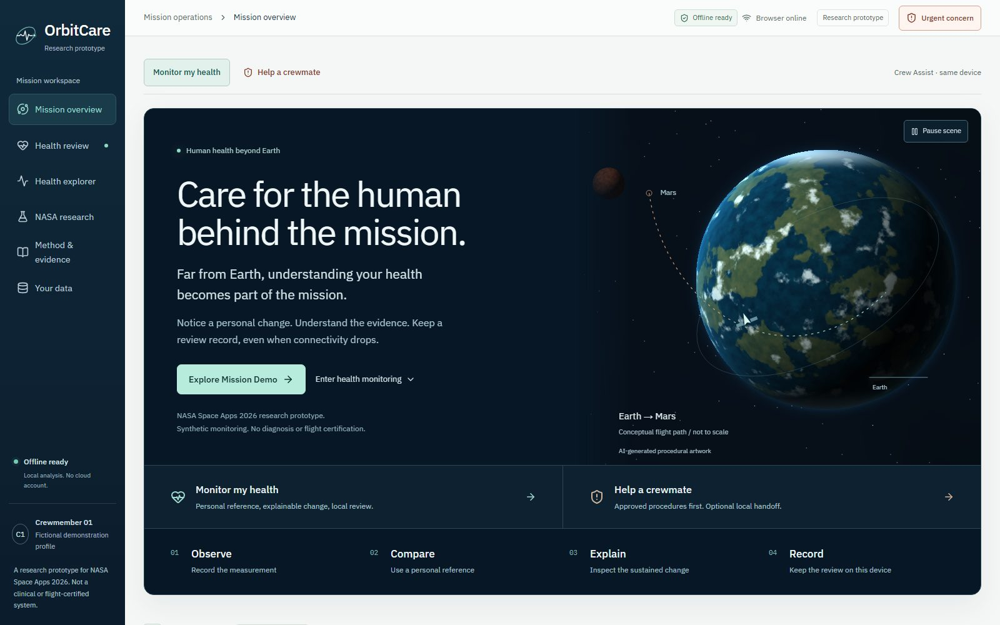
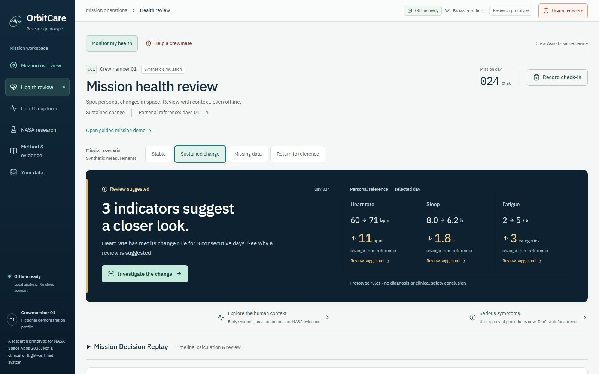
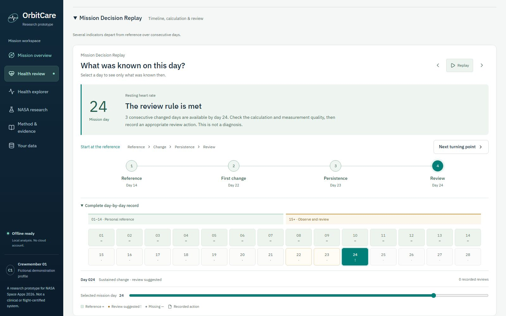
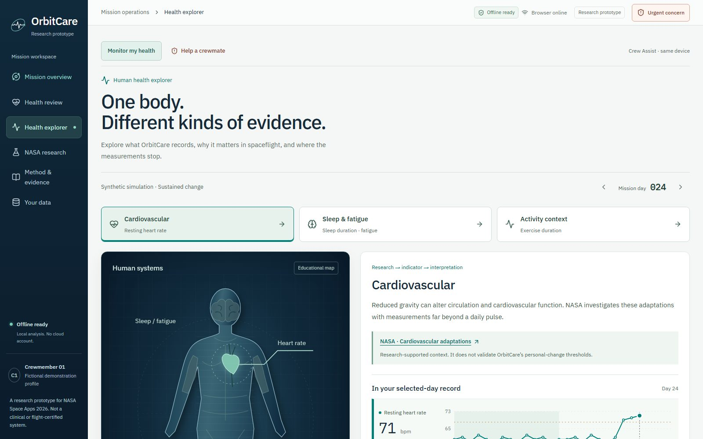
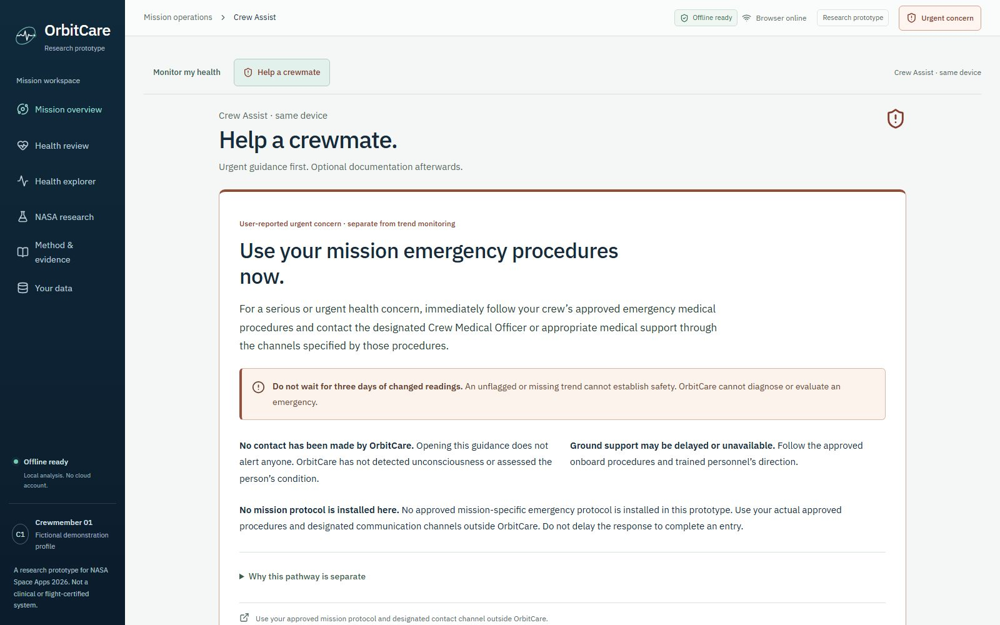
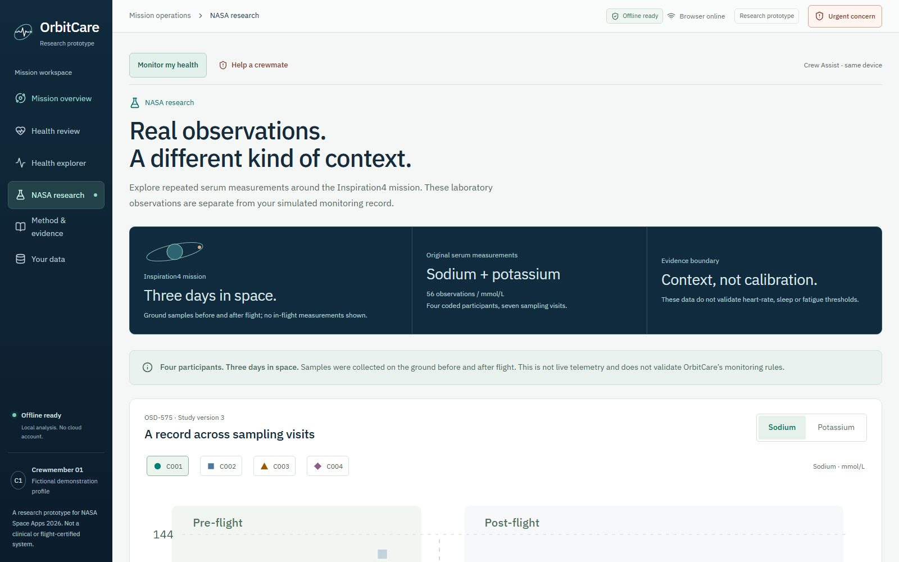
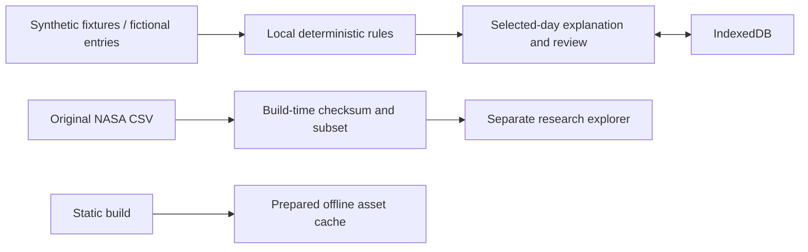

# OrbitCare — Astronaut Health Monitoring & Crew Assistance

**Notice a personal change. Inspect the reasoning. Keep a review record offline.**

OrbitCare turns individual readings into an explainable monitoring-to-review workflow: a fixed personal reference, explicit persistence rules, selected-day decision replay and locally saved reviews. Crew Assist adds a separate way to help a fictional crewmate and prepare a handoff on the same device.

[**Open the application**](https://orbitcare-eight.vercel.app/) · [**Watch the 28-second demo**](https://orbitcare-eight.vercel.app/demo/) · [Seven-slide presentation](https://orbitcare-eight.vercel.app/demo/OrbitCare-seven-slides.pdf) · [Get started](docs/GETTING_STARTED.md)



Developed collectively by **Bihandu Liyanage and Nesandu Liyanage**, Local Event **Anuradhapura, Sri Lanka**, for the **NASA Space Apps Challenge 2026** challenge [Create Health Monitoring Software for Astronauts on Space Missions](https://www.spaceappschallenge.org/2026/challenges/health-monitoring-software/). Submitted for judging on **November 15, 2026**, as reported by the team. No award, endorsement or clinical validation is claimed.

> Research prototype. Monitoring scenarios are synthetic or manually entered test measurements. The separate NASA laboratory explorer contains original research observations. OrbitCare does not diagnose, treat, contact medical support or establish mission safety. Do not enter private medical information.

## Why OrbitCare

An isolated measurement says little about a sustained individual change. Far from Earth, reviewing the comparison and recording uncertainty must also work when a connection is unavailable. OrbitCare makes **reading → personal comparison → quality assessment → explanation → recorded review → prepared offline continuity** inspectable, without an opaque health score.

| Implemented capability | What you can inspect |
| --- | --- |
| **Personal monitoring and explanations** | Heart rate, sleep and ordinal fatigue against fixed days 1–14; contextual exercise; exact values, quality, calculations and explicit three-day rules |
| **Mission Decision Replay** | Reference, first change, persistence and review using only information available through the selected day; slider, next turning point and pausable playback |
| **Interactive Human Health Explorer** | Schematic cardiovascular, head and muscle regions connected to selected-day records and research; keyboard and text alternatives |
| **Crew Assist** | Urgent guidance, optional source-labeled notes, fictional Mars day-24 drill, explicit historical snapshots, JSON/text handoff and Print / Save as PDF |
| **Prepared offline workflow** | Local analysis, check-ins, reviews, bundled evidence, research and export after **Offline ready** confirms preparation |
| **Separate NASA OSD-575 explorer** | 56 original sodium/potassium observations, four coded participants, seven categorical ground visits, original mmol/L, CSV and provenance |



<details>
<summary>Explore the actual application screens</summary>

Captures use a fresh local production application and the shipped synthetic scenario. These post-submission captures are not generated UI mockups or clinical records.

**Mission Decision Replay**



**Interactive Human Health Explorer**



**Crew Assist**



**NASA OSD-575 research**



</details>

## Try the workflow

1. Enter monitoring directly or choose **Explore Mission Demo** for five stages using the working application.
2. Compare **Stable**, **Sustained change**, **Missing data** and **Return to reference**. Choose **Investigate the change** to inspect the selected-day explanation and timeline.
3. Record a fictional review. It stays on the device, does not contact anyone and does not clear computed flags. The guided demo has a separate review workspace.
4. Wait for **Offline ready**, disconnect and reload. Record another review and reload again. Persistence alone does not prove offline reopening.
5. Open **NASA research** for actual laboratory measurements. Choose **Help a crewmate** for urgent signposting and optional fictional handoff documentation.

**Urgent concern** directs immediately to actual approved mission procedures and designated medical personnel, independently of gradual trend rules. No mission-specific emergency protocol is installed.

## Run locally

Use **Node.js 26.8.1** and npm; no environment variables, account or API keys are required.

```sh
git clone https://github.com/biha-pixel/OrbitCare.git
cd OrbitCare
npm ci
npm run dev
```

Visit <http://localhost:3000>. Until publication is approved, cloning requires authorized private-repository access. For the actual offline application:

```sh
npm run build
npm start
```

Visit <http://127.0.0.1:3000> and wait for **Offline ready**. Use HTTPS or localhost, not a directly opened HTML file. Development mode does not register the service worker. See [setup and troubleshooting](docs/GETTING_STARTED.md).

## Engineering and verification

Static **Next.js 16.4.6 / React 19.3.0**, TypeScript, Tailwind CSS, Recharts, Zod and IndexedDB. Native WebGL/GLSL, SVG and CSS provide original procedural graphics, with a static fallback and reduced-motion support. Lucide icons and locally bundled IBM Plex fonts retain their licenses. There is no application backend, authentication, runtime generative AI, wearable connection or automatic synchronization.



[Architecture](docs/ARCHITECTURE.md) · [Scientific methodology](docs/SCIENTIFIC_METHODOLOGY.md) · [NASA provenance](NASA_DATA_SOURCES.md)

```sh
npm run lint
npm run typecheck
npm test
npm run build
npx playwright install chromium
npm run test:e2e
```

Vitest checks analysis, portability, replay, incidents and original NASA values. Playwright and axe exercise browser workflows, accessibility and genuine offline reopening. [Testing](docs/TESTING.md) documents prerequisites; the dated [release audit](docs/RELEASE_AUDIT.md) records actual results and remaining risks. No unrun CI or coverage badge is claimed. `npm run data:prepare` reproduces the NASA subset from checked-in bytes without network access.

## Scientific and data boundaries

The reference statistics, illustrative fatigue scale, change floors and three-calendar-day rule are unvalidated engineering assumptions. NASA research informs context, not those thresholds. Missing or non-comparable observations interrupt persistence. Four short-mission research participants cannot validate long-duration rules. Highlighted body regions are educational navigation, not organ-health conclusions.

Browser records and exports are not encrypted by OrbitCare. Storage clearing/eviction can erase records; multi-tab/device synchronization is not implemented. An unprepared first visit, external research pages and uncached demo media require connectivity. Clinical performance, improved outcomes, flight certification and astronaut usability have not been established. Read the [scientific limitations](SCIENTIFIC_LIMITATIONS.md), [Crew Assist boundaries](CREW_ASSIST.md) and [security policy](SECURITY.md).

## Open development, credit and licensing

Both team members jointly directed and refined OrbitCare, including Crew Assist. OpenAI Codex assisted requirements, research inspection, architecture, implementation, synthetic fixtures, tests, documentation, deployment and media tooling. Procedural artwork is visibly disclosed. The official demo uses actual application captures and edited composition. A separate narrated candidate uses disclosed Kokoro speech and licensed Scott Buckley music; it has not replaced the silent demo. See [AI_USE.md](AI_USE.md) and [audio credits](public/demo/OrbitCare-audio-credits.txt).

Original code/documentation use the existing **[MIT license](LICENSE)**. Datasets, music, fonts, icons, dependencies and agent guidance keep separate terms; they are not relicensed under MIT. See [THIRD_PARTY_NOTICES.md](THIRD_PARTY_NOTICES.md), [REFERENCES.md](REFERENCES.md) and the [license choice for owner approval](docs/LICENSE_DECISION.md).

[Contribute](CONTRIBUTING.md) · [Private vulnerability reporting](SECURITY.md) · [Documentation](docs/README.md) · [Submission revision and release plan](docs/RELEASE_PLAN.md)
