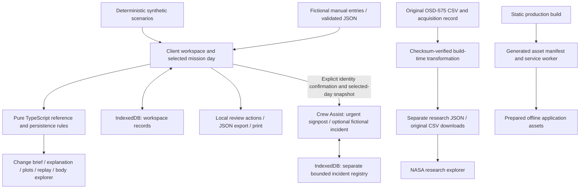

# Architecture

OrbitCare is a Next.js App Router application exported to static HTML/CSS/JavaScript. `app/page.tsx` mounts the client workspace in `components/orbitcare.tsx`. There are no API routes, backend database, runtime NASA queries or cloud AI calls.

## Main responsibilities

| Location | Responsibility |
| --- | --- |
| `app/` | Entry, layout, manifest, local fonts and styles |
| `components/orbitcare.tsx` | Workspace state, selected day, navigation, persistence status, imports/exports |
| `lib/analysis.ts`, `lib/replay.ts` | Pure comparisons, explicit rules and information available through the selected day |
| `components/monitor-view.tsx`, `change-brief.tsx`, `mission-timeline.tsx`, `explanation.tsx`, `metric-plot.tsx` | Progressive investigation, exact values, milestones and transparent reasoning |
| `components/health-explorer.tsx`, `mission-space.tsx`, `mission-walkthrough.tsx` | Educational body selection, optional original procedural WebGL scene and five-stage demo |
| `lib/validation.ts`, `lib/persistence.ts` | Strict portability schemas and IndexedDB workspace persistence |
| `lib/crew-incident.ts`, `lib/crew-persistence.ts`, `components/crew-assist.tsx` | Fictional drill, source-labeled handoff and separately bounded local incident records |
| `data/scenarios.ts`, `data/evidence.ts`, `data/guidance.ts` | Synthetic fixtures and attributed explanatory context |
| `scripts/prepare-data.mjs`, `data/raw/`, `data/research.json` | Original research bytes, acquisition provenance and reproducible selected observations |
| `scripts/generate-sw.mjs`, `lib/use-offline.ts` | Content-versioned asset cache, readiness checks and explicit update handling |

Monitoring input is validated, compared locally and displayed without mixing NASA laboratory observations into the rules. Exercise is contextual, not a fourth alerted indicator. Reviews do not change calculated flags. Replay filters observations and reviews through the selected day; future missingness is not revealed early.

Crew Assist reuses urgent guidance before optional documentation. It does not infer an emergency, supply treatment, install a mission protocol or contact anyone. Historical context enters only through explicit confirmation and a bounded selected-day snapshot. See [CREW_ASSIST.md](../CREW_ASSIST.md).

## Persistence and offline lifecycle

IndexedDB database `orbitcare`, version 1, uses the `state` object store. Workspace and crew registries use separate keys (`workspace`, `crew-incidents`), not separate devices or authenticated accounts. Loaded/saved structures are schema-checked. The UI surfaces persistence failures; multi-tab conflict resolution is not implemented.

The build verifies the original NASA bytes, exports Next.js into `out/`, then hashes production files and generates `out/sw.js`. The `/demo/` subtree and source maps are excluded from precaching. Installation caches the manifest; **Offline ready** is shown only after the worker confirms every asset. Updates wait for explicit activation. Same-origin static asset fetches use the cache; personal records remain in IndexedDB. This preserves offline analysis after preparation, not first-visit availability or guaranteed durable storage.

`scripts/serve.mjs` is a local static preview. `vercel.json` and `scripts/prepare-vercel.mjs` carry host headers; Next.js runtime headers cannot configure a separate static host. See [SECURITY.md](../SECURITY.md) for the trust model and limited CSP.
